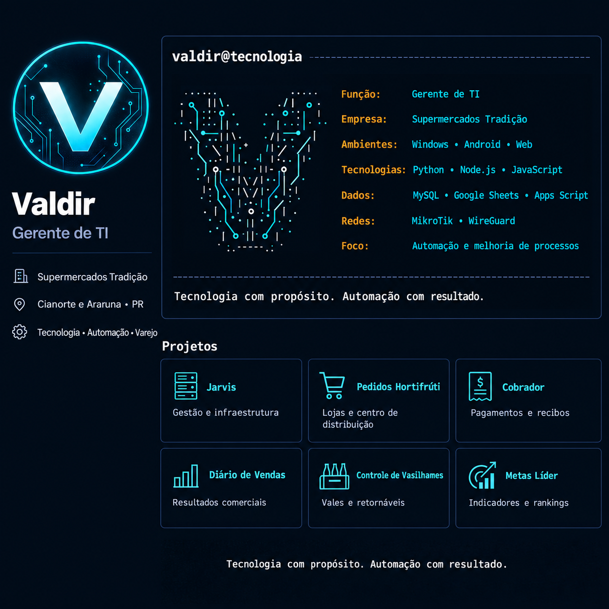

h1 align="center">Valdir</h1>
<p align="center"><strong>Gestão de TI • Automação • Aplicativos para o varejo</strong></p>
<p align="center">Transformando necessidades do dia a dia em soluções práticas.</p>

```yaml
valdir@tecnologia:
  função: Gerente de TI
  empresa: Supermercados Tradição
  atuação: Cianorte e Araruna — Paraná, Brasil
  idioma: Português

  ambientes:
    - Windows, Android e aplicações web
    - Redes MikroTik e conexões WireGuard
    - Node.js, Python, MySQL e XAMPP

  projetos_com:
    - JavaScript, HTML, CSS e Tailwind
    - Google Sheets e Apps Script
    - GitHub, PWA e aplicativos Android

  foco:
    - Gestão e suporte de infraestrutura de TI
    - Automação de rotinas e integração de sistemas
    - Indicadores de vendas e acompanhamento de metas
    - Aplicativos para simplificar a operação do varejo
    - IA aplicada à produtividade e à comunicação visual

  princípio: Entender o processo, simplificar a rotina e entregar resultado.
```

### Sobre mim

Sou gerente de TI no Supermercados Tradição, com atuação em Cianorte e Araruna, no Paraná. Meu trabalho conecta infraestrutura, suporte e melhoria de processos às necessidades reais da operação.

Além da gestão de TI, desenvolvo projetos de automação e aplicativos com apoio de inteligência artificial. Trabalho em soluções para pedidos, cobranças, vendas, metas e controles internos, buscando reduzir tarefas repetitivas e facilitar o acesso às informações.

Também atuo em projetos de tecnologia e comunicação visual ligados à New Source Tecnologia. Tenho interesse em transformar ideias em ferramentas úteis, testar seu funcionamento na prática e aprimorá-las com base no uso diário.

### Projetos em que trabalho

| Projeto | Objetivo |
| :--- | :--- |
| **Jarvis** | Centralizar módulos de gestão, infraestrutura e automação em um painel. |
| **Pedidos Hortifrúti** | Facilitar os pedidos das lojas e a consolidação pelo centro de distribuição. |
| **Cobrador** | Organizar contribuições, pagamentos, lembretes e recibos de uma associação de moradores. |
| **Diário de Vendas Serallê** | Registrar vendas e acompanhar resultados comerciais. |
| **Controle de Vasilhames** | Organizar a emissão e a baixa de vales de embalagens retornáveis. |
| **Metas Líder Atacadista** | Acompanhar desempenho, rankings e evolução das vendas. |

### O que busco construir

Ferramentas simples de usar, com informações claras e funções que resolvam problemas concretos. Meu foco é aproximar a tecnologia de quem trabalha na operação e transformar dados em decisões úteis.

<p align="center"><strong>Tecnologia com propósito. Automação com resultado.</strong></p>
